# GeminiSuperBrain
Gemini 超级大脑提供 30 项服装电商图像创作功能。上传模特照和服装平铺图或人台图，就能预览模特穿上这件衣服的效果。你还可以给服装换色、换印花、换面料，提取面料花型，调整模特姿势和拍摄背景，或生成摆拍细节图和 3D 卖点主图。

## 功能介绍

https://github.com/user-attachments/assets/debb89f2-af0b-454f-ad4c-481043726781

## 功能说明书

以下案例按说明书顺序展示。每组图片从左到右依次为上传的参考图和生成结果。

[下载完整网页版说明书](https://github.com/dba9524-crypto/GeminiSuperBrain/releases/download/v5.9.0/GeminiSuperBrain-Manual.html)，用浏览器打开可放大查看原图。

### 01 模特换衣+人台/平铺都行

图1 → 图2 → 生成结果

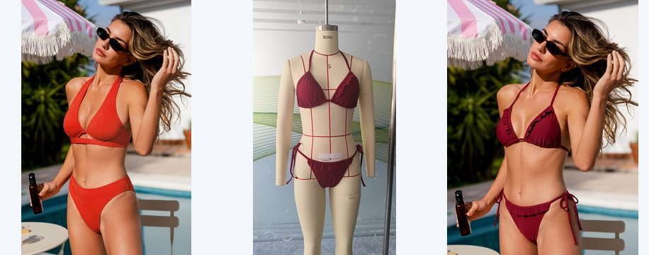

### 02 模特图+背面图(可以是人台摆拍)

图1 → 图2 → 生成结果

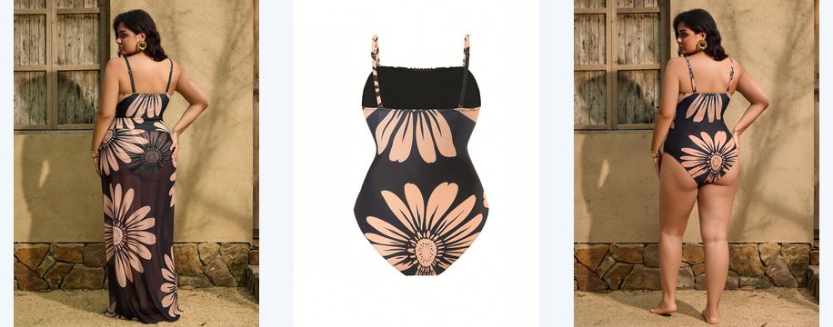

### 03 图1衣服图，图2印花图。模特换印花图案

图1 → 图2 → 生成结果

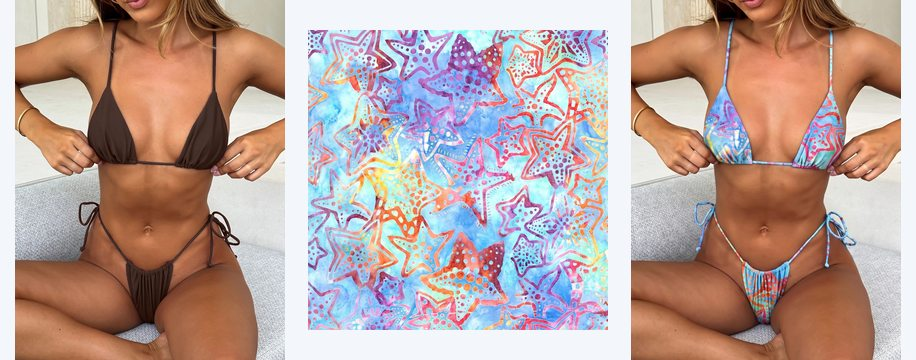

### 04 摆拍细节图

图1 → 图2 → 生成结果

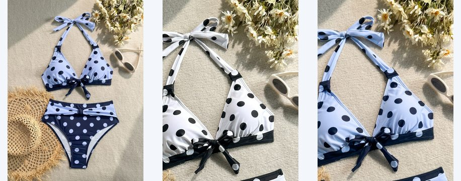

### 05 模特换动作-有头部五官的

图1 → 生成结果

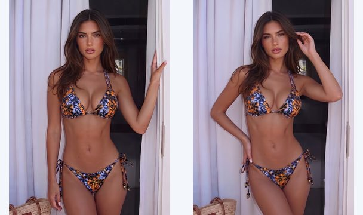

### 06 改背景，动作，角度

图1 → 生成结果

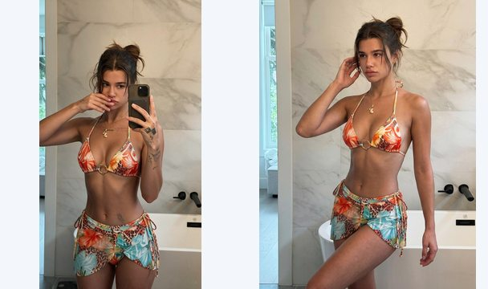

### 07 图1是人台图-图2是衣服图/模特图

图1 → 图2 → 生成结果

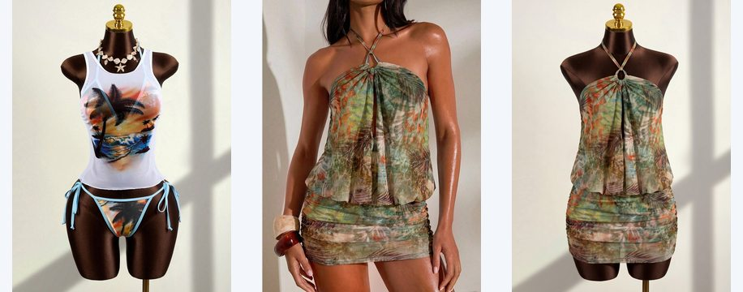

### 08 模特定制动作。图2上传火柴人或者想要的动作图

图1 → 图2 → 生成结果

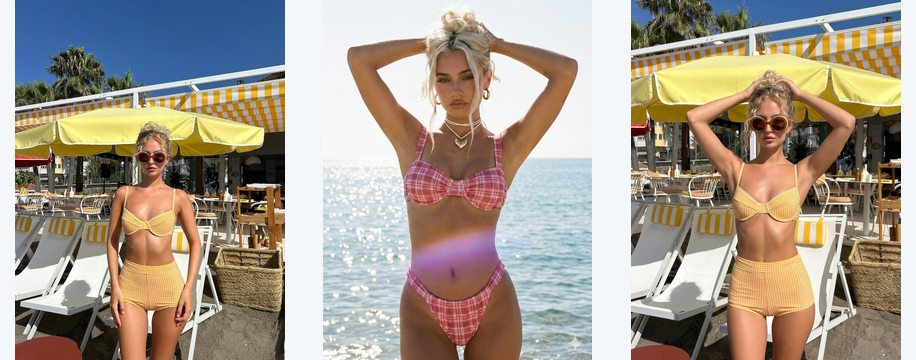

### 09 换脸-图2想要的脸部

图1 → 图2 → 生成结果

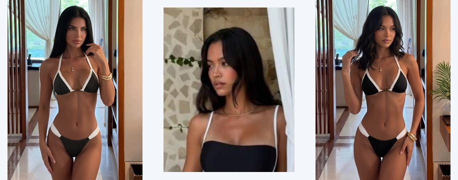

### 10 换色

图1 → 图2 → 生成结果

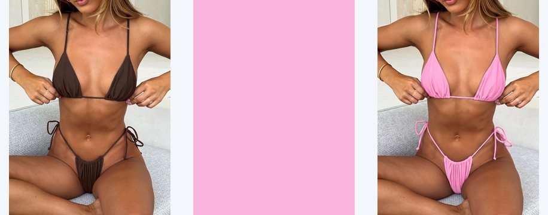

### 11 模特换背景，1是人，2是背景

图1 → 图2 → 生成结果

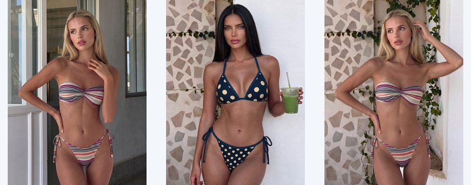

### 12 平铺图换色

图1 → 图2 → 生成结果

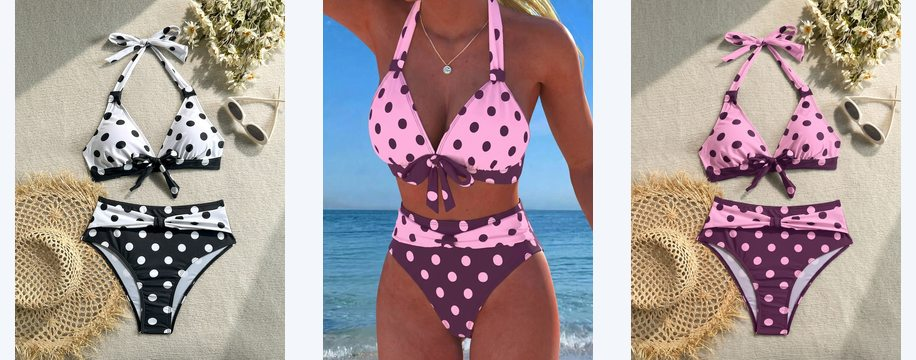

### 13 生成3D卖点纸质背景主图

图1 → 生成结果

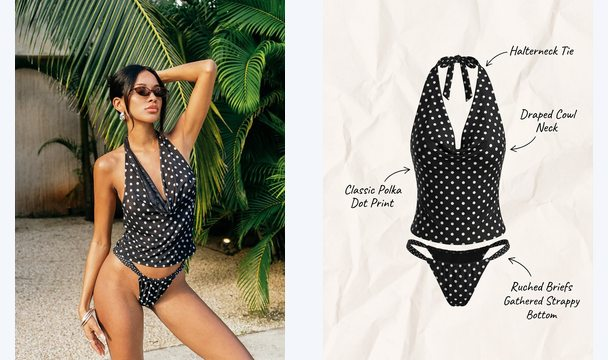

### 14 模特换动作-无头的换动作

图1 → 生成结果

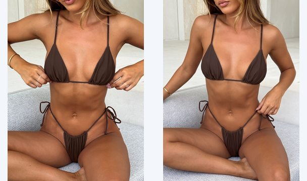

### 15 换面料-图2是想要的面料

图1 → 图2 → 生成结果

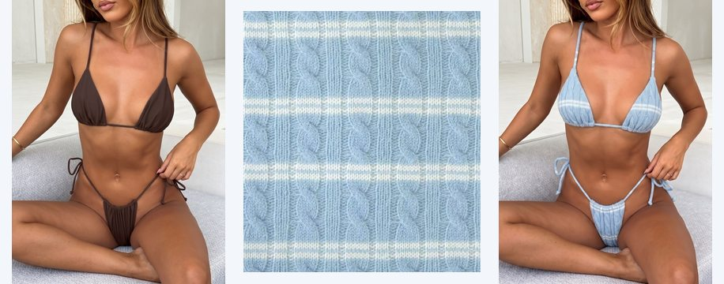

### 16 3D建模图/长裙类搭配图

图1 → 生成结果

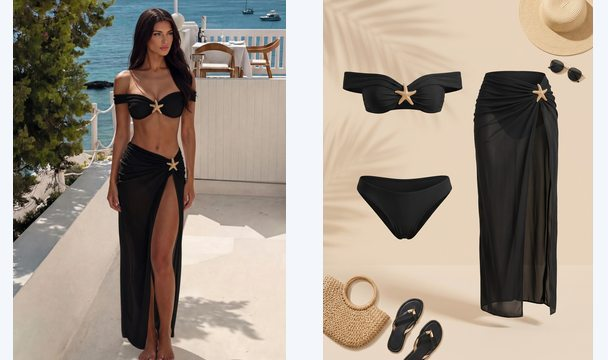

### 17 摆拍图换背景图1衣服，图2背景

图1 → 图2 → 生成结果

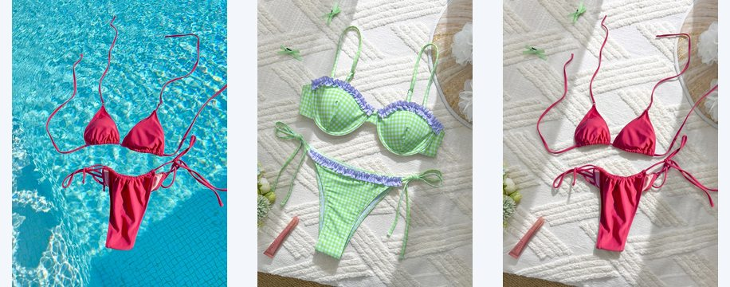

### 18 单图版，换元素首饰道具

图1 → 生成结果

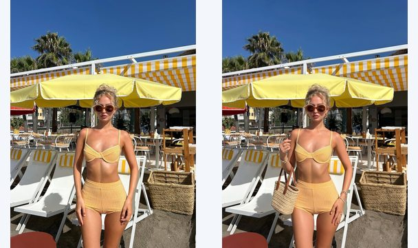

### 19 模特图+人台侧面

图1 → 图2 → 生成结果

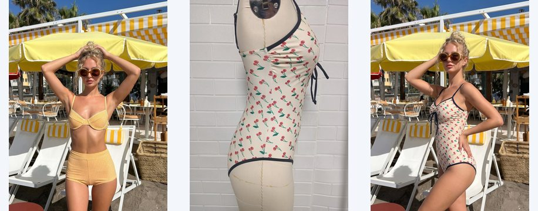

### 20 改角度，背景-动作-海边版

图1 → 生成结果

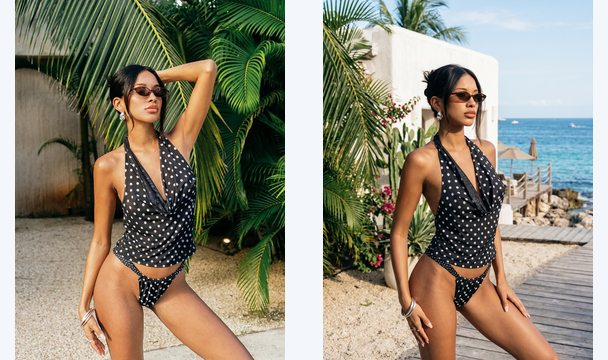

### 21 专属圆点换色

图1 → 图2 → 图3 → 生成结果

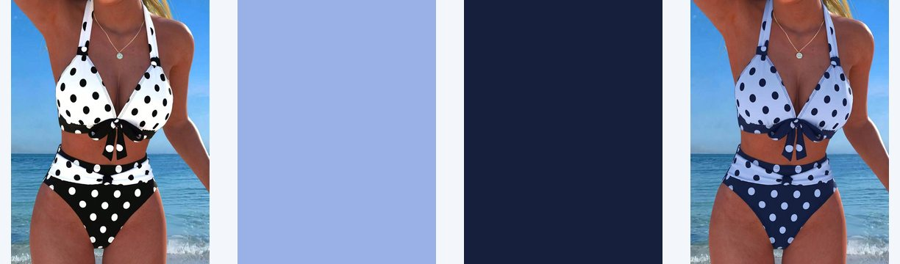

### 22 特殊面料改印花图

图1 → 图2 → 生成结果

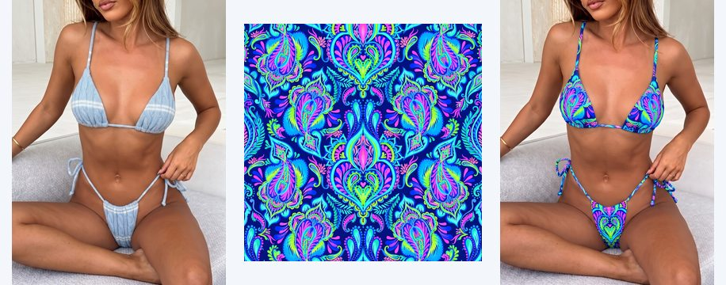

### 23 补充头部

图1 → 生成结果

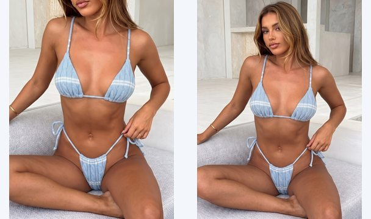

### 24 图1是原图，图2是首饰道具的

图1 → 图2 → 生成结果

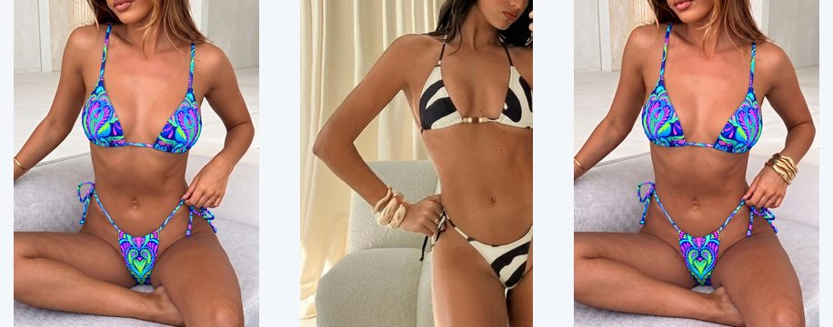

### 25 3D 卡通迪士尼公主风格

图1 → 生成结果

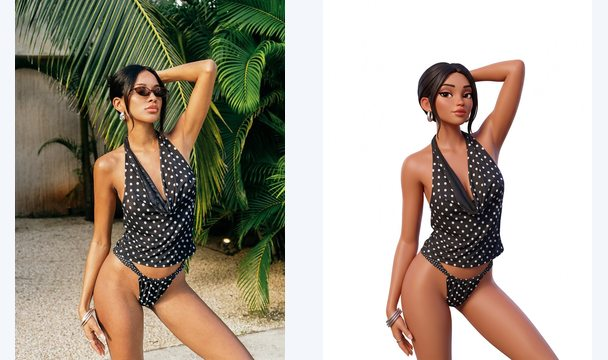

### 26 面料印花提取

图1 → 生成结果

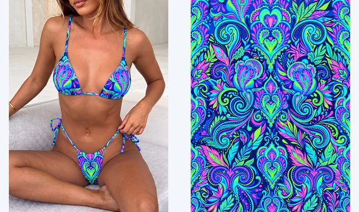

### 27 面料填写纹理网纱/布纹通用

图1 → 图2 → 生成结果

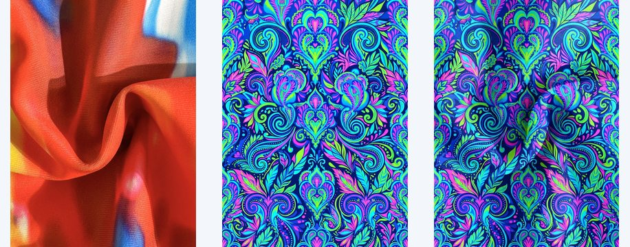

### 28 像素风人物

图1 → 生成结果

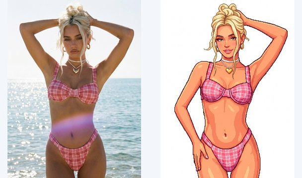

### 29 泡泡玛特泥塑大头娃娃风格

图1 → 生成结果

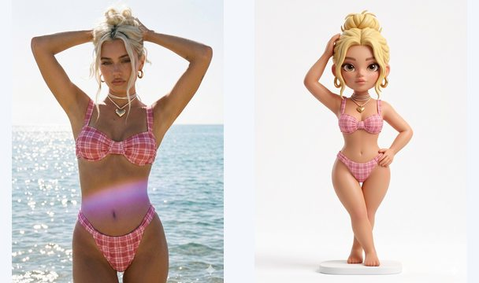

### 30 建模改真人摄影

图1 → 生成结果

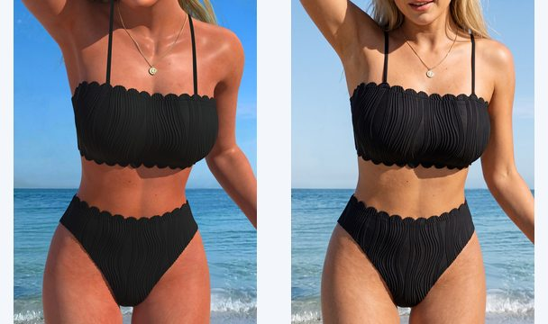
